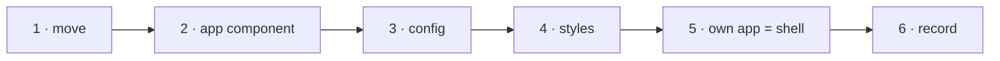

# W-33 — `@pdfsuite/ui`: the screens as a package

## At a glance

| | |
|---|---|
| **What** | Move today's screens out of `src/` into `packages/ui`: Compare, Bulk compare, Spec, Inspect as components, and `<PdfSuiteApp/>` that mounts them all |
| **Why** | Created apps must receive new screens and features on upgrade; copied screens cannot be synced |
| **Done when** | This repository's own app is a thin shell rendering `<PdfSuiteApp/>`; every tab works as today; each tab imports only its own package |
| **Status** | 🟡 waiting · 0 of 6 DoD done |
| **Waits on** | W-29 |
| **Who** | `agent` · Opus |
| **Record** | SR-NPM-PACKAGES |



<details>
<summary><b>ASCII twin</b></summary>

```text
  1 move --> 2 app component --> 3 config --> 4 styles --> 5 own app = shell --> 6 record
```

</details>

**Arpit, 2026-10-18:** *"There is going to be a UI that is going to get created for spec,
compare, and bulk compare, and inspect, like a React application … when we upgrade pdf
suite, we might be trying to sync with the newer files and newer functionalities."*

**Model:** Opus: the whole UI moves package without a visible change.

## How it can be built

- **Components:** `CompareView`, `BulkCompareView`, `SpecView`, `InspectView`, and
  `<PdfSuiteApp config={…}/>` with the workspace tabs (named per W-06).
- **Imports:** Compare and Bulk from `@pdfsuite/compare`, Spec from `@pdfsuite/spec`, Inspect
  from `@pdfsuite/core` — nothing else (SR-NPM-PACKAGES decision 6).
- **Config, not edits:** enabled tabs, base path, theme tokens, feature flags — passed as
  props, so a created app never has to change a component.
- **Styles** ship with the package (one CSS file, prefixed classes); React is a peer dependency.
- **Spec tab:** mounted only when `@pdfsuite/spec` is installed (W-32).

## Definition of done

| DoD | what | state |
|---|---|---|
| 1 · move | `src/components`, `src/store`, `App.tsx` move to `packages/ui`, unchanged in behaviour | ⏳ |
| 2 · app component | `<PdfSuiteApp/>` and one component per tab exported | ⏳ |
| 3 · config | tabs, base path, theme, flags as props; `flag.env` becomes the repository app's config | ⏳ |
| 4 · styles | one stylesheet shipped with the package; class names prefixed | ⏳ |
| 5 · own app = shell | this repository's app is exactly what `create` writes for a new app, plus its config | ⏳ |
| 6 · record | SR-NPM-PACKAGES decision 7 marked built; `docs/ARCHITECTURE.md` UI shell redrawn | ⏳ |

## Blockers

- 🟡 **Waiting on W-29** — the workspace and the `ui` shell must exist.

## Record affected

[SR-NPM-PACKAGES](../../records/0107_NPM-packages.md) decisions 6, 7, 11.

## Hazards

- **Sealed folder:** the Spec tab's components live in `src/features/spec/` until W-32's ruling — import them, never move them from this machine.
- **No logic in `ui`** — anything that changes a result belongs in a domain package (L3, L4 decision 3).

## Reference

- `src/App.tsx` · `src/components/` · `src/store/` · `flag.env` · [SR-LAW-4](../../records/0006_LAW-4-how-packages-work.md)
