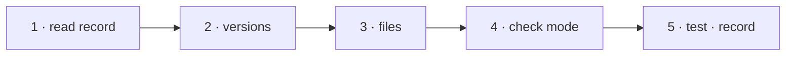

# W-34 — `--sync`: upgrade an app without overwriting what a team changed

## At a glance

| | |
|---|---|
| **What** | `npm create @pdfsuite@latest -- --sync` reads `.pdfsuite/installed.json`, bumps every `@pdfsuite/*` dependency to one version, replaces shell files whose hash is unchanged, and writes `*.pdfsuite-new` beside edited ones |
| **Why** | Arpit: an app installed once must sync with newer files and functionality on upgrade (L4 decision 5) |
| **Done when** | On a sample app with one edited and one untouched file, sync replaces the untouched one, leaves the edited one, writes its `.pdfsuite-new`, and lists it; `--check` exits 1 when behind |
| **Status** | 🟡 waiting · 0 of 5 DoD done |
| **Waits on** | W-31 |
| **Who** | `agent` · Sonnet |
| **Record** | SR-NPM-PACKAGES |



<details>
<summary><b>ASCII twin</b></summary>

```text
  1 read record --> 2 versions --> 3 files --> 4 check mode --> 5 test + record
```

</details>

**Arpit, 2026-10-18:** *"We could have installed it once and later on when we upgrade pdf
suite, we might be trying to sync with the newer files and newer functionalities."*

**Model:** Sonnet: hash comparison and file writes, with every rule fixed in the record.

## How it can be built

- **The record:** `.pdfsuite/installed.json` (W-31) — version, and each file with its SHA-256.
- **Per file:** missing → write; hash matches the record → replace; hash differs → write
  `<file>.pdfsuite-new`, list it, keep the original; deleted by the consumer → stay deleted
  (`--restore` brings it back).
- **`package.json`:** only `@pdfsuite/*` entries change, all to the same exact version.
- **Report:** a summary of replaced, added, kept-with-`.pdfsuite-new`, and skipped files.
- **`--check`:** no writes; exit 1 when the app is behind, for CI.

## Definition of done

| DoD | what | state |
|---|---|---|
| 1 · read record | `installed.json` read and validated; a missing record → exit 2 with "run create first" | ⏳ |
| 2 · versions | every `@pdfsuite/*` dependency set to one exact version; nothing else in `package.json` touched | ⏳ |
| 3 · files | the four file rules above; the record rewritten with new hashes | ⏳ |
| 4 · check mode | `--check` writes nothing, exits 1 when behind | ⏳ |
| 5 · test · record | a test on a sample app proves each rule; SR-NPM-PACKAGES decision 8 marked built | ⏳ |

## Blockers

- 🟡 **Waiting on W-31** — the record of installed files is written there.

## Record affected

[SR-NPM-PACKAGES](../../records/0107_NPM-packages.md) decision 8; [SR-LAW-4](../../records/0006_LAW-4-how-packages-work.md) decision 5 becomes enforced.

## Hazards

- **Never overwrite an edited file** — the veto condition of L4.
- Line-ending changes alter a hash — normalise to `\n` before hashing, and say so.

## Reference

- [SR-NPM-PACKAGES](../../records/0107_NPM-packages.md) · [W-31](W-31-create-pdfsuite-app.md)
