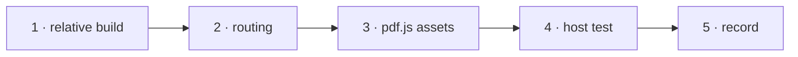

# W-35 — the app as a static single-page app at any URL

## At a glance

| | |
|---|---|
| **What** | The built app works from any URL and sub-path on any static host: relative assets, hash routing by default, pdf.js worker, fonts and character maps served beside it |
| **Why** | Arpit: a React application which can be hosted on any URL as a single-page app |
| **Done when** | The build served from `/` and from `/some/sub/path/` by a plain static server loads, deep-links to every tab, and compares a fixture |
| **Status** | 🟡 waiting · 0 of 5 DoD done |
| **Waits on** | W-33 |
| **Who** | `agent` · Sonnet |
| **Record** | SR-NPM-PACKAGES |



<details>
<summary><b>ASCII twin</b></summary>

```text
  1 relative build --> 2 routing --> 3 pdf.js assets --> 4 host test --> 5 record
```

</details>

**Arpit, 2026-10-18:** *"Like a React application, which can be hosted on any URL as a
single page app."*

**Model:** Sonnet: build configuration and a hosting test.

## How it can be built

- **Vite `base: './'`** so every asset URL is relative.
- **Routing:** hash routes (`#/compare`, `#/spec` …) by default — deep links work on any host
  with no rewrite rule; a `basePath` option for hosts that rewrite to `index.html`.
- **pdf.js assets** (worker, `standard_fonts/`, `cmaps/` — W-13) resolved relative to the
  page, never from a CDN.
- **No server, no network:** the app never sends a PDF anywhere (SR-NPM-PACKAGES decision 12).
- **CSP:** the worker loads from a file URL, not a `blob:`, so a strict policy works.

## Definition of done

| DoD | what | state |
|---|---|---|
| 1 · relative build | `base: './'`; no absolute asset path in the build output | ⏳ |
| 2 · routing | hash routes for every tab; `basePath` option documented | ⏳ |
| 3 · pdf.js assets | worker, fonts and character maps load relative to the page | ⏳ |
| 4 · host test | Playwright against a static server at `/` and at a sub-path: every tab deep-links; a fixture compares; no request leaves the host | ⏳ |
| 5 · record | SR-NPM-PACKAGES decision 9 marked built; a hosting section in the README | ⏳ |

## Blockers

- 🟡 **Waiting on W-33** — the app is built from `@pdfsuite/ui`.

## Record affected

[SR-NPM-PACKAGES](../../records/0107_NPM-packages.md) decisions 9 and 12.

## Hazards

- Today's app may assume `/` — grep for absolute paths in `src/` and `index.html`.

## Reference

- `vite.config.ts` · `index.html` · [W-13](W-13-pdf-loader-fonts-cmaps.md) · [SR-NPM-PACKAGES](../../records/0107_NPM-packages.md)
