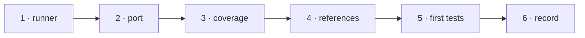

# W-36 — `npm test`: the runner, decision coverage, reference outputs and the first tests

## At a glance

| | |
|---|---|
| **What** | One `npm test` on Node's built-in runner; today's `cli/verify` checks ported into it; a check listing every record decision without a test; reference outputs with `test:approve`; the first unit and property tests on today's engine |
| **Why** | SR-TESTING: a feature is proven when every decision of its record has a test — nothing runs tests today |
| **Done when** | `npm test` passes in under two minutes; it fails when a reference output changes without approval; the decision-coverage list prints |
| **Status** | 🟢 ready · 0 of 6 DoD done |
| **Waits on** | nothing |
| **Who** | `agent` · Sonnet |
| **Record** | SR-TESTING |



<details>
<summary><b>ASCII twin</b></summary>

```text
  1 runner --> 2 port --> 3 coverage --> 4 references --> 5 first tests --> 6 record
```

</details>

**Arpit, 2026-10-18:** *"Let's go ahead and create a work item for all these test cases and create an SR document for testing as well … Can we run testing on actual PDFs and Excel file? We can create some sample test data and then we can go ahead and test it out."*

**Model:** Sonnet: wiring a runner and porting four scripts; the rules are fixed in SR-TESTING.

## How it can be built

- **Runner:** `node --test`, built into Node 20+; TypeScript bundled by the esbuild already in `cli/`.
- **Port, do not rewrite:** `cli/verify/classification.ts`, `regression.ts`, `spec-target.ts`, `detail.ts` become tests with the same assertions. `make-cases.py`'s pairs are regenerated in TypeScript with pdf-lib.
- **Decision coverage:** test names carry `SR-NAME dN`; a script reads every accepted record's numbered decisions and lists the ones no test names.
- **Reference outputs:** `test/expected/` beside each test; `npm run test:approve` rewrites them and prints the diff.
- **First tests on today's engine:** page rule at 1.9 / 2.0 / 2.1 px and 99.99 % / 0.2 %; compare(X, X) passes; swapping sides swaps added and removed; two runs give the same bytes.

## Definition of done

| DoD | what | state |
|---|---|---|
| 1 · runner | root `npm test` runs `node:test` across the repo; under two minutes | ⏳ |
| 2 · port | the four `cli/verify` scripts as tests, assertions unchanged; `make-cases.py` replaced by a TypeScript generator | ⏳ |
| 3 · coverage | decision-coverage script prints every accepted record decision with no test | ⏳ |
| 4 · references | `test/expected/` and `npm run test:approve` with a printed diff | ⏳ |
| 5 · first tests | verdict boundaries and the three property checks on today's engine | ⏳ |
| 6 · record | SR-TESTING decisions 1, 2, 6, 7 marked enforced; `CLAUDE.md` names `npm test` | ⏳ |

## Blockers

None.

## Record affected

[SR-TESTING](../../records/0116_TESTING.md) — the decisions this item enforces.

## Hazards

- **Python:** ruled 2026-10-18 (SR-STACK-TYPESCRIPT decision 4) — `make-cases.py` is ported to TypeScript and deleted in the same change; its pairs must come out byte-identical first.
- Tests must not need the network or a browser.
- Fictional data only; never a real workbook or PDF in this repository.

## Reference

- `cli/verify/` · `cli/package.json` · [SR-TESTING](../../records/0116_TESTING.md)
