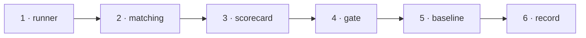

# W-38 — Run the sample set end to end and score it

## At a glance

| | |
|---|---|
| **What** | `npm run test:samples` runs compare, bulk, spec and inspect over the sample set through the app path and the CLI, compares the findings with `expected.json`, and writes a scorecard |
| **Why** | Arpit: run testing on actual PDFs and Excel files — the proof that the tool works on realistic documents, not just on functions |
| **Done when** | The scorecard lists, per set and deviation type, found · missed · extra; a missed planted deviation or an extra finding on a matching document fails the run |
| **Status** | 🟡 waiting · 0 of 6 DoD done |
| **Waits on** | W-37 |
| **Who** | `agent` · Opus |
| **Record** | SR-TESTING |



<details>
<summary><b>ASCII twin</b></summary>

```text
  1 runner --> 2 matching --> 3 scorecard --> 4 gate --> 5 baseline --> 6 record
```

</details>

**Arpit, 2026-10-18:** *"Let's go ahead and create a work item for all these test cases and create an SR document for testing as well … Can we run testing on actual PDFs and Excel file? We can create some sample test data and then we can go ahead and test it out."*

**Model:** Opus: matching findings to planted deviations fairly — by page, type and position tolerance — decides what "found" means.

## How it can be built

- **Today first:** run against today's engine and CLI, so the scorecard shows where the product stands now; deviations marked "not caught yet" in `expected.json` are reported, not failed.
- **Matching:** a finding matches a planted deviation when page and type agree and positions fall within 0.05 in; each finding matches at most one deviation.
- **Both surfaces:** each run through the app path (the core, as the tab calls it) and the CLI; their `result.json` must match (L3).
- **Scorecard:** `test-results/scorecard.json` and a readable `scorecard.md` — per set, per type, with timings and peak memory (SR-TESTING performance budgets).
- **Spec machine:** the same command runs there on real workbooks; its scorecard stays there.

## Definition of done

| DoD | what | state |
|---|---|---|
| 1 · runner | `npm run test:samples` over every set | ⏳ |
| 2 · matching | the matching rule above, unit-tested | ⏳ |
| 3 · scorecard | `scorecard.json` and `scorecard.md`: found, missed, extra, time, memory | ⏳ |
| 4 · gate | a miss of a "should catch" deviation, or an extra finding on a matching document, fails | ⏳ |
| 5 · baseline | today's scorecard committed, so every later item shows its gain | ⏳ |
| 6 · record | SR-TESTING decision 5 marked enforced | ⏳ |

## Blockers

- 🟡 **Waiting on W-37** — the sample set must exist before it can be run.

## Record affected

[SR-TESTING](../../records/0116_TESTING.md) — the decisions this item enforces.

## Hazards

- **Do not tune to the sample:** a change that only helps the sample set and hurts SR-PDF-SUPPORT fixtures is a regression.
- Timing numbers vary by machine — budgets are generous and trend-tracked, never a hair trigger.
- Fictional data only; never a real workbook or PDF in this repository.

## Reference

- [W-37](W-37-sample-test-data.md) · [SR-TESTING](../../records/0116_TESTING.md) · `cli/verify/`
