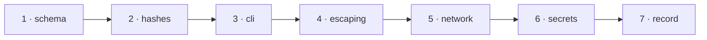

# W-39 — Contract and security tests for the three output files and the CLI

## At a glance

| | |
|---|---|
| **What** | Tests that every `result.json` validates against its schema, every manifest hash verifies, exit codes and the console shape are exact, hostile text stays escaped, no network request happens and no secret is written |
| **Why** | SR-TESTING: the outputs are a contract with pipelines and people; a leak or an injection is a failure even when the verdict is right |
| **Done when** | The contract and security suites run in `npm test` and fail on any schema error, hash mismatch, unescaped value, network request or secret in an output |
| **Status** | 🟡 waiting · 0 of 7 DoD done |
| **Waits on** | W-27 |
| **Who** | `agent` · Sonnet |
| **Record** | SR-TESTING |



<details>
<summary><b>ASCII twin</b></summary>

```text
  1 schema --> 2 hashes --> 3 cli --> 4 escaping --> 5 network --> 6 secrets --> 7 record
```

</details>

**Arpit, 2026-10-18:** *"Let's go ahead and create a work item for all these test cases and create an SR document for testing as well … Can we run testing on actual PDFs and Excel file? We can create some sample test data and then we can go ahead and test it out."*

**Model:** Sonnet: test code against rules fixed in SR-REPORT-JSON, SR-MANIFEST, SR-CLI and SR-REPORT-HTML.

## How it can be built

- **Schema:** validate every written `result.json` and `manifest.json` (validator per the owed choice in SR-TESTING decision 10).
- **Hashes:** recompute every SHA-256 the manifest lists.
- **Exit-code matrix:** pass, fail, bad argument, unreadable file, wrong password, missing package, version mismatch.
- **Console:** stdout is exactly the SR-CLI shape; everything else is on stderr.
- **Escaping fuzz:** PDF text, file names, spec values and units containing `<script>`, quotes, `&`, RTL marks — `report.html` must contain none unescaped.
- **No network:** Node — fail if `http`, `https`, `net` or `fetch` is used during a run; browser — Playwright fails on any request off the host.
- **No secrets:** run with a known password and API header; grep every output for them.

## Definition of done

| DoD | what | state |
|---|---|---|
| 1 · schema | result and manifest validated in every engine test | ⏳ |
| 2 · hashes | manifest hashes recomputed | ⏳ |
| 3 · cli | exit-code matrix and console shape | ⏳ |
| 4 · escaping | hostile-text fuzz over `report.html` | ⏳ |
| 5 · network | network guard in Node runs | ⏳ |
| 6 · secrets | password and header never in any output | ⏳ |
| 7 · record | SR-REPORT-JSON, SR-MANIFEST, SR-CLI, SR-REPORT-HTML veto conditions run as tests | ⏳ |

## Blockers

- 🟡 **Waiting on W-27** — the shared builders produce the outputs these tests check.

## Record affected

[SR-TESTING](../../records/0116_TESTING.md) — the decisions this item enforces.

## Hazards

- Until W-27 and W-09 land, test today's writers and mark the cases that move with them.
- Fictional data only; never a real workbook or PDF in this repository.

## Reference

- [SR-REPORT-JSON](../../records/0109_REPORT-json.md) · [SR-MANIFEST](../../records/0110_MANIFEST.md) · [SR-CLI](../../records/0115_CLI.md) · [SR-REPORT-HTML](../../records/0108_REPORT-html.md)
