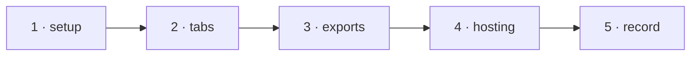

# W-40 — Browser tests: every tab's main flow in Playwright

## At a glance

| | |
|---|---|
| **What** | Playwright runs each tab on the sample set — Compare (Side by side, Overlapping, report), Bulk compare, Spec, Inspect — plus export, import and hosting at a sub-path |
| **Why** | SR-TESTING: the app is a surface (L3); its flows must be proven in a real browser, where fonts and rendering differ from Node |
| **Done when** | `npm run test:e2e` passes on Linux; each tab loads sample files, shows the expected verdict and counts, and exports the three files |
| **Status** | 🟡 waiting · 0 of 5 DoD done |
| **Waits on** | W-33 |
| **Who** | `agent` · Sonnet |
| **Record** | SR-TESTING |



<details>
<summary><b>ASCII twin</b></summary>

```text
  1 setup --> 2 tabs --> 3 exports --> 4 hosting --> 5 record
```

</details>

**Arpit, 2026-10-18:** *"Let's go ahead and create a work item for all these test cases and create an SR document for testing as well … Can we run testing on actual PDFs and Excel file? We can create some sample test data and then we can go ahead and test it out."*

**Model:** Sonnet: scripted browser flows against fixed expectations.

## How it can be built

- **Playwright** as a dev-only dependency (owed choice, SR-TESTING decision 10); the pre-installed Chromium in CI.
- **Flows:** load a pair → verdict and page strip match `expected.json`; Next change stops on every failing page; Bulk with an orphan; Spec with the workbook; Inspect a named element's distances.
- **Exports:** the Export menu's three files equal the CLI's for the same pair (L3).
- **Hosting:** W-35's sub-path build, deep links to every tab.
- **Network:** any request off the host fails the test.

## Definition of done

| DoD | what | state |
|---|---|---|
| 1 · setup | Playwright config, dev dependency, `npm run test:e2e` | ⏳ |
| 2 · tabs | one flow per tab on the sample set | ⏳ |
| 3 · exports | app export bytes equal CLI outputs | ⏳ |
| 4 · hosting | sub-path build and deep links | ⏳ |
| 5 · record | SR-TESTING browser row marked enforced | ⏳ |

## Blockers

- 🟡 **Waiting on W-33** — the screens must be the `@pdfsuite/ui` package the tests drive.

## Record affected

[SR-TESTING](../../records/0116_TESTING.md) — the decisions this item enforces.

## Hazards

- Browser and Node rendering differ — compare verdicts and counts, not pixels, across surfaces.
- Fictional data only; never a real workbook or PDF in this repository.

## Reference

- [W-33](W-33-ui-package.md) · [W-35](W-35-spa-any-url.md) · [SR-TESTING](../../records/0116_TESTING.md)
