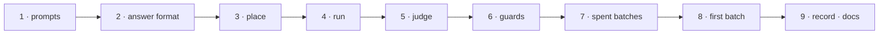

# W-41 — Blind batches: independent test data, a sealed answer key, a person-run judge

## At a glance

| | |
|---|---|
| **What** | Two generation prompts, the answer format, `blind:place`, `blind:run`, `blind:judge`, and the guards that keep the answer key away from every AI agent |
| **Why** | Arpit: test data made by an AI with no view of this project, so the answers are an honest exam — compare and spec, 10–20 cases at a time |
| **Done when** | A batch made from the prompt in a fresh chat is placed, run and judged; the judge prints found · missed · extra and verdict agreement; every guard blocks an agent reading the sealed folder in a test |
| **Status** | 🟢 ready · 0 of 9 DoD done |
| **Waits on** | nothing |
| **Who** | `agent` · Opus |
| **Record** | SR-TESTING |



<details>
<summary><b>ASCII twin</b></summary>

```text
  1 prompts --> 2 answer format --> 3 place --> 4 run --> 5 judge --> 6 guards --> 7 spent batches --> 8 first batch --> 9 record + docs
```

</details>

**Arpit, 2026-10-18:** *"An independent chat in Claude, Codex or anywhere in AI is going to
generate that test data independent to this project so that it doesn't get a visibility into
what the answers are … I'll copy it and put it in one of the directories which can never be
accessed by any AI agent ever."* … *"Add hooks, add messages, add restrictions, but that's
how I am going to do … I'll place the files and then I'm going to run a script. It is going
to pick the report from this repository and the golden set … and it is going to give me
outputs."*

**Model:** Opus: the prompts decide whether the exam is fair, and the guards decide whether
it stays blind.

## How it can be built — research, 2026-10-18

**1 · The prompts** — `testing/blind/PROMPT-compare.md`, `PROMPT-spec.md`, self-contained:
- **Compare:** N cases (default 10, up to 20); fictional, varied documents (statement, invoice,
  letter, payslip, policy, form, brochure), 1–6 pages, made with varied PDF libraries;
  0–4 deviations per case from the catalogue; ~15 % identical controls (expected PASS) and
  ~10 % restyle-only cases (expected PASS under the page rule).
- **Spec:** a workbook in the Template v2 layout with a Pages List, a PDF that matches it,
  and deviations planted in some cases; each deviation names its sheet and cell.
- **Self-check:** the generator extracts text and renders both PDFs in its sandbox and lists
  only deviations it confirmed.
- **Output:** `inputs.zip` (case folders) and `answers.zip` (`answers.json` + `answers.html`), never one zip.
- **Public contracts only:** the catalogue, the answer schema, the page rule, the spec
  template — no code, no record text, no answers.

**2 · The answer format** — `pdfsuite.blind-answers/1`:
`batch`, `kind` (compare · spec), `generator` (tool, model, date), `cases[]` with `id`, file
names, `expected_verdict`, and `deviations[]`: `id`, `page`, `type` (from the catalogue),
`before`, `after`, `box_in` (optional), `cell` (spec), `verified: true`.
Catalogue — compare: text-changed · text-added · text-removed · moved · font-changed ·
size-changed · colour-changed · image-changed · table-row-added · table-row-removed ·
page-missing · page-extra · page-order; spec: position-off · size-off · font-off ·
colour-off · wording-off · element-missing · page-missing · page-order.

**3 · `npm run blind:place -- <inputs.zip | folder>`** — unzips into
`testing/blind/inputs/<batch>/case-NN/`; refuses `answers.*` or any file carrying the answer
schema; writes `batch.json` (kind, cases, input SHA-256); prints the next command.

**4 · `npm run blind:run -- <batch>`** — runs `pdfsuite compare` per case (today's CLI through
an adapter until W-09; then `--out` per case) and `pdfsuite spec` per case (the engine's
headless check with a JSON spec until W-11; `.xlsx` once its Node reader exists) into
`testing/blind/runs/<batch>/case-NN/`.

**5 · `npm run blind:judge -- <batch> [--answers <path>]`** — zero-dependency Node:
reads the key from `--answers`, else `PDFSUITE_BLIND_ANSWERS`, else
`testing/blind/answers/<batch>/`; matches per SR-TESTING decision 14; prints a per-case
table and totals; writes `testing/blind/results/<batch>/scorecard.json` and `.md`.
Reads today's CLI JSON through an adapter until `result.json` (SR-REPORT-JSON) exists.

**6 · The guards** (SR-TESTING decision 13):
- `.gitignore`: `testing/blind/answers/` and `answers.zip`.
- Claude Code `permissions.deny` for `Read`, `Edit`, `Write`, `Grep`, `Glob` on the folder,
  and a `PreToolUse` hook (`.claude/hooks/guard-blind-answers.sh`) blocking any tool input
  naming the folder, `PDFSUITE_BLIND_ANSWERS` or `answers.json`, with a message saying why.
- Messages: `AGENTS.md` (Codex), `.kiro/steering/blind-answers.md` (always included),
  `.github/copilot-instructions.md`, and one pointer line in `CLAUDE.md`.
- A commit containing an answer file is refused by `scripts/sr-guard.sh`.
- The judge refuses when stdin is not a terminal or a known agent variable is set
  (`CLAUDECODE`, and others found by testing), and asks for the batch id to be typed.

**7 · Spent batches** — `testing/blind/batches.json` records each batch: placed, run,
judged, spent. `npm run blind:retire -- <batch>` (person only) moves a spent batch's inputs
and key into the regression sample set (W-37).

## Definition of done

| DoD | what | state |
|---|---|---|
| 1 · prompts | `PROMPT-compare.md` and `PROMPT-spec.md`, public contracts only, self-check, two zips | ⏳ |
| 2 · answer format | `pdfsuite.blind-answers/1` schema and catalogue in `testing/blind/` | ⏳ |
| 3 · place | `blind:place` with the answer-file refusal and `batch.json` | ⏳ |
| 4 · run | `blind:run` for compare now; spec through the engine now, the CLI after W-11 | ⏳ |
| 5 · judge | `blind:judge`: matching rule, per-case table, totals, scorecard files; adapters for today's outputs | ⏳ |
| 6 · guards | gitignore, deny rules, hook with message, `AGENTS.md`, Kiro steering, Copilot instructions, commit refusal, judge's agent refusal — each proven by a test | ⏳ |
| 7 · spent batches | `batches.json` and `blind:retire` | ⏳ |
| 8 · first batch | one compare and one spec batch generated in fresh chats, placed, run and judged by Arpit; the scorecard committed | ⏳ |
| 9 · record · docs | SR-TESTING decisions 11–16 marked enforced; `testing/blind/README.md`; `CLAUDE.md` pointer | ⏳ |

## Blockers

None. The spec half runs on JSON specs until W-11 brings `.xlsx` to Node; the judge reads
today's outputs until W-09 and W-27 land.

## Record affected

[SR-TESTING](../../records/0116_TESTING.md) decisions 11–16; `CLAUDE.md` gains one pointer
line (SR-WORK-DOCS decision 7 — say it out loud).

## Hazards

- **No guard inside the repository is absolute** — an agent with a shell can read any file
  it can reach. Say so in the README; the safe place is outside the repository, never
  connected to an agent session.
- **Never read the answer key while building this** — test the guards with a dummy key.
- **The generator can be wrong:** a judge disagreement is triaged by a person — our bug,
  generator error, or an unclear rule — never auto-accepted either way.
- **Overfitting:** fixing the tool for one revealed batch spends it; the next exam is a new batch.
- **Fictional only;** generated cases carry no real client data.

## Reference

- [SR-TESTING](../../records/0116_TESTING.md) · [SR-COMPARE](../../records/0111_COMPARE.md) · [SR-SPEC](../../records/0112_SPEC.md) · [SR-REPORT-JSON](../../records/0109_REPORT-json.md) · [SR-SPEC-INTAKE](../../records/0101_SPEC-intake.md)
- `.claude/settings.json` · `scripts/sr-guard.sh` · [W-37](W-37-sample-test-data.md) · [W-09](W-09-pdfsuite-compare-one-pair.md) · [W-11](W-11-pdfsuite-spec-cli.md)
