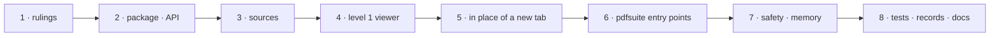

# W-42 — `<pdfsuite-pdf-viewer>`: open any PDF in a pop-up, not a new tab

## At a glance

| | |
|---|---|
| **What** | A web component, `<pdfsuite-pdf-viewer>` in `@pdfsuite/viewer`, that shows any PDF — bank statement, proposal, a test PDF — in a pop-up over the current page, from React, Vue or plain HTML; sources are a File, Blob, bytes, URL, base64 or data URI; pdfsuite's tabs use the same element |
| **Why** | Arpit: in Chrome a PDF in a single-page app always leaves for a new tab; it should open in place, from any app, and grow features over time |
| **Done when** | Level 1 ships: a demo page opens a PDF from each source kind in the pop-up without a new tab; every pdfsuite tab and finding opens it; Esc closes it and memory is released |
| **Status** | 🔴 blocked on Arpit's go-ahead and an L4 ruling · 0 of 8 DoD done |
| **Waits on** | Arpit saying build · an L4 ruling on `@pdfsuite/viewer`, a web-component package outside `ui` |
| **Who** | `agent` · Sonnet |
| **Record** | SR-SURFACE-PARITY (UI-only row) · SR-NPM-PACKAGES gains `@pdfsuite/viewer` (ruling owed) |



<details>
<summary><b>ASCII twin</b></summary>

```text
  1 rulings --> 2 package + API --> 3 sources --> 4 level 1 viewer --> 5 in place of a new tab
    --> 6 pdfsuite entry points --> 7 safety + memory --> 8 tests + records + docs
```

</details>

**Arpit, 2026-10-18 (first ask):** *"Create PDF viewer inside single page app. That means a pop-up
window will open up within the single page app where you can view the PDFs. Research on how it
can be done, file the work item and keep it blocked until I say so … block it on Arpit."*

**Arpit, 2026-10-18 (clarified):** *"PDF viewer wasn't from the sense that on left hand side we
have golden PDF, on right hand side we have the testing PDF. It was more from the point today in
a browser you cannot open a PDF within a single page app. It always open up in a new tab … instead
of opening a new tab, whenever there is a PDF, it can be shown within the tab as a pop-up … it can
be any PDF. It could be bank statements, it could be proposals, it could be in base 64 and so on.
… that PDF viewer can be used within the testing tool as well … and in that PDF viewer, slowly by
slowly, we can add more and more features."*

**Arpit, 2026-10-18 (web components):** *"PDF viewer and Excel viewer and Excel editor need to be web
components so that it can be used with React, Vue, or any kind of framework."*

**Model:** Sonnet: assembling pdf.js's own viewer components inside a native dialog, behind a
custom element.

## Why a browser opens a new tab today — research, 2026-10-18

- A PDF link or `window.open(blobUrl)` hands the bytes to the browser's own viewer, which only
  runs as a whole page — so a single-page app loses its place.
- Chrome blocks top-level navigation to `data:` URLs, so a base64 PDF cannot even be opened
  that way; it must be decoded to bytes first.
- An `<iframe src="blob:…">` works in desktop Chrome but differs per browser, is absent on
  some mobiles, cannot highlight anything, and is blocked by a strict CSP.
- **So the viewer renders the PDF itself with pdf.js** — already a pinned dependency — inside a
  native `<dialog>` on the current page.

## The design

**API — a custom element, so it works in any framework or none:**

```html
<script type="module">import '@pdfsuite/viewer'</script>
<pdfsuite-pdf-viewer src="/files/proposal.pdf" name="Home loan proposal.pdf" page="1" open></pdfsuite-pdf-viewer>
```

| part | what |
|---|---|
| attributes | `src` (URL, data URI or base64) · `name` · `page` · `open` · `level` (cap the toolbar) |
| properties | `source` (File, Blob, ArrayBuffer, Uint8Array, `PDFDocumentProxy`) · `boxes` (rectangles in inches) · `password` (callback, W-16) |
| events | `pdfsuite-open` · `pdfsuite-close` · `pdfsuite-page` (`detail.page`) · `pdfsuite-error` (`detail.reason`) |
| methods | `show()` · `close()` · `goTo(page)` |
| styling | Shadow DOM; colours and radii through CSS custom properties (`--pdfsuite-accent`, …) and `::part(toolbar)` |
| helpers | `openPdf(source, options)` creates the element, appends it, opens it, returns it · `interceptPdfLinks(root)` makes PDF links under `root` open in it |

- React 19 passes properties and events to custom elements natively; Vue and Angular need
  only their "this is a custom element" setting. No wrapper package.
- A `string` is a URL, a `data:application/pdf;base64,…` URI, or bare base64 — told apart by
  shape; base64 is decoded in chunks with a size cap from SR-CONSTANTS.
- A URL is fetched by the host page, so cross-origin needs CORS; on failure the viewer says so
  and offers "open in a new tab" as the fallback.
- **Reuse a loaded document:** pdfsuite's tabs pass their `PDFDocumentProxy`; nothing is parsed twice.

**Levels — features arrive one level at a time; each level after 1 is its own item when Arpit asks:**

| level | adds |
|---|---|
| **1 · read** | dialog with title, page n of N, previous / next, scroll, zoom (fit width, fit page, %), download the original, print, Esc to close; every source kind; `interceptPdfLinks` |
| 2 · find | thumbnails rail, search with match count, text selection and copy, rotate view, keyboard shortcuts, password prompt (W-16) |
| 3 · understand | outline / bookmarks, document properties (W-26), attachments, page kind label (W-20) |
| 4 · review | boxes from a finding drawn on the page (pdfsuite), annotations and form fields shown (W-17, W-19), a second document side by side |

**In pdfsuite (DoD 6):** a *View* action wherever a PDF is loaded — Compare (one pair and many
pairs), Spec check, Inspect — opens that PDF; a finding's *View* opens its PDF at its page with
its box. Golden and test are two separate opens, never one split view (a level-4 option only).

**Safety and memory**
- PDF JavaScript stays off (`enableScripting` never set); links in a PDF open in a new tab with
  `rel="noopener noreferrer"`.
- On close: `viewer.cleanup()`, listeners removed, canvases released, a document the viewer
  opened destroyed; a document passed in by a tab is left alone.
- No network beyond fetching a URL the host gave; the viewer never sends a PDF anywhere.

## Definition of done

| DoD | what | state |
|---|---|---|
| 1 · rulings | Arpit says build; the L4 ruling on `@pdfsuite/viewer` as a web-component package outside `ui` recorded in SR-NPM-PACKAGES; this item re-balled 🟢 and its inbox row removed | ⏳ |
| 2 · package · element | `packages/viewer` (W-44 layout): `<pdfsuite-pdf-viewer>` per the API table, `openPdf`, `interceptPdfLinks`; no framework; Shadow DOM; pdf.js from the same pinned `pdfjs-dist` as the engine; a demo page using it from plain HTML, React and Vue | ⏳ |
| 3 · sources | File, Blob, ArrayBuffer, Uint8Array, URL, data URI and bare base64 each open; a bad or oversized input says what is wrong | ⏳ |
| 4 · level 1 viewer | the level-1 row above, in a `<dialog>` opened with `showModal()`: focus trapped, focus returned on close | ⏳ |
| 5 · in place of a new tab | a demo page (`apps/viewer` stays backlog B-015; a fixture page here) with a PDF link, a blob, a URL and a base64 string — each opens in the pop-up, none in a new tab | ⏳ |
| 6 · pdfsuite entry points | *View* in Compare (both scopes), Spec check and Inspect, and on findings (page + box) | ⏳ |
| 7 · safety · memory | scripting off, safe links, cleanup proven by a memory check over ten open/close cycles | ⏳ |
| 8 · tests · records · docs | Playwright flow (W-40); SR-SURFACE-PARITY viewer row ratified as UI-only; SR-NPM-PACKAGES package row; `docs/ARCHITECTURE.md` updated | ⏳ |

## Blockers

- 🔴 **Arpit's go-ahead** — he says when it is to be built (inbox row).
- 🔴 **L4 ruling.** L4 decision 3 puts screens only in `ui`, and decision 6 makes adding a
  package a ruling. Recommended: `@pdfsuite/viewer` as a **web-component package** — a
  framework-free custom element any app installs alone; `ui` consumes it. The alternative,
  putting it in `ui`, drags React and every screen into a bank-statement page. (The sheet and
  its error list are **sheetpane**, Arpit's separate package — a dependency, not a pdfsuite
  package — so they need no L4 ruling: W-46, W-47.)

## Record affected

[SR-SURFACE-PARITY](../../records/0106_SURFACE-parity.md) — the *PDF viewer pop-up* row (UI only,
presentation). [SR-NPM-PACKAGES](../../records/0107_NPM-packages.md) — a `@pdfsuite/viewer` row,
on the ruling. W-44's future-product table already places `@pdfsuite/viewer`; the standalone
`apps/viewer` stays backlog B-015.

## Hazards

- **Presentation only:** the viewer reads results, never computes them (L3).
- **Large PDFs and large base64:** render visible pages only; decode base64 in chunks; cap sizes.
- **pdf.js version:** viewer components from the same `pdfjs-dist` as the engine, pinned exactly
  (SR-NPM-PACKAGES decision 10); worker, fonts and CMaps from W-13, nothing from a CDN (W-35).
- **CORS:** a cross-origin URL without CORS cannot be fetched; the fallback is a new tab, said plainly.

## Reference

- Designs: *PDF Suite — Proof redesign* canvas — *Viewer · any app*, *Viewer · in pdfsuite*, *Viewer · levels*
- `node_modules/pdfjs-dist/web/pdf_viewer.mjs` · `pdf_viewer.css`
- [SR-SURFACE-PARITY](../../records/0106_SURFACE-parity.md) · [SR-NPM-PACKAGES](../../records/0107_NPM-packages.md) · [SR-LAW-4](../../records/0006_LAW-4-how-packages-work.md) · [W-13](W-13-pdf-loader-fonts-cmaps.md) · [W-16](W-16-password-protected-pdfs.md) · [W-33](W-33-ui-package.md) · [W-35](W-35-spa-any-url.md) · [W-40](W-40-browser-tests-playwright.md) · [W-44](W-44-monorepo-layout.md) · [W-46](W-46-sheet-viewer.md) · [W-47](W-47-sheet-editor.md)
