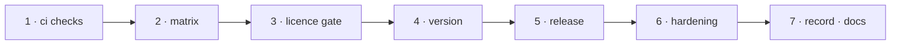

# W-43 — CI/CD: test every change, publish the packages on approval

## At a glance

| | |
|---|---|
| **What** | A CI pipeline running every check on each pull request and push, and a release pipeline that publishes all `@pdfsuite` packages together, with provenance, after Siddharth or Arpit approves |
| **Why** | Arpit: a CI/CD pipeline to test and publish the package |
| **Done when** | A pull request shows every check; a tagged release, once approved, publishes every package at one version with a provenance attestation, and a fresh install of each works |
| **Status** | 🟢 ready · 0 of 7 DoD done |
| **Waits on** | nothing — the release half publishes once W-29's packages exist |
| **Who** | `agent` · Opus |
| **Record** | SR-NPM-PACKAGES, SR-TESTING |



<details>
<summary><b>ASCII twin</b></summary>

```text
  1 ci checks --> 2 matrix --> 3 licence gate --> 4 version --> 5 release --> 6 hardening --> 7 record + docs
```

</details>

**Arpit, 2026-10-18:** *"Add a work item to create CI/CD pipeline to test and publish the
package."*

**Model:** Opus: a release pipeline that can publish to a public registry must be right the
first time.

## How it can be built — research, 2026-10-18

- **Trusted publishing (npm, generally available since 2025-07-31):** a workflow publishes
  through OIDC with **no stored npm token**, and npm adds a **provenance attestation
  automatically**; it needs npm CLI 11.5.1+, and supports **GitHub Actions** (GitHub-hosted
  runners) and **GitLab CI/CD** (gitlab.com runners) — not Jenkins, as of that announcement.
- **Ruled (Arpit, SR-TESTING decision 10):** this repository's CI is **GitHub Actions**; Jenkins is the consumers' CI and no Jenkins job is part of this repository. Packages go to the `pdfsuite` organisation on npm.
- **Not a dependency under L2:** the CI system is chosen by the team; the product does not
  need it (SR-LAW-2 decision 5).

**CI — every pull request and push to `main`** (`.github/workflows/ci.yml`):
`npm ci` → build every workspace → `npm test` → `npm run test:samples` →
`npm run test:e2e` (Playwright, Linux) → Ajv schema checks → `npm run test:pack` → licence check (B-014) →
`scripts/check-boundary.sh`, `scripts/check-work-items.sh`, `scripts/check-open-work-inbox.py`.
Node 20 and 22 on Linux block the merge; macOS and Windows run and report only (SR-TESTING
decision 8).

**Release — on a `v*` tag** (`.github/workflows/release.yml`):
1. The `release` environment requires **approval by Siddharth or Arpit**.
2. Every `@pdfsuite` package carries the tag's version — otherwise stop (L4 decision 4).
3. Full CI again, then `npm pack` every package and install-test the tarballs.
4. Publish in dependency order — core, agents, cli, compare, spec, ui, create — with
   trusted publishing; `@pdfsuite/spec` is skipped until W-32's ruling.
5. Install each package fresh from the registry and run its smoke test; a failure is
   reported, never silently retried.
6. Attach the tarballs and the scorecard to the GitHub release.

**One version:** `npm run release:version -- <x.y.z>` sets every package and their internal
dependencies to the same exact version and creates the tag.

## Definition of done

| DoD | what | state |
|---|---|---|
| 1 · ci checks | `ci.yml` runs every command above; a failing check blocks the merge | ⏳ |
| 2 · matrix | Node 20 and 22 on Linux blocking; macOS and Windows reporting | ⏳ |
| 3 · licence gate | the B-014 licence check fails CI on any licence outside SR-LAW-2 | ⏳ |
| 4 · version | `release:version` sets one version everywhere and tags it | ⏳ |
| 5 · release | `release.yml`: approval gate, version check, pack-and-install test, publish in order with trusted publishing, post-publish install test | ⏳ |
| 6 · hardening | actions pinned by commit SHA; least-privilege `permissions:`; no secrets printed; Dependabot or equivalent for the actions | ⏳ |
| 7 · record · docs | SR-NPM-PACKAGES decision 13 marked built; a RELEASING section in `README.md` | ⏳ |

## Blockers

None for the CI half, which starts on today's layout. The release half publishes once the packages exist (W-29).
- **W-10 DoD 7** (publish) is done through this pipeline.

## Record affected

[SR-NPM-PACKAGES](../../records/0107_NPM-packages.md) decisions 10, 13 and 15; [SR-TESTING](../../records/0116_TESTING.md) decisions 8 and 10.

## Hazards

- **A public publish is hard to undo** — npm's unpublish window is short; the approval gate is not optional.
- **Never publish the spec mirror** without W-32's ruling.
- **Bundled licences:** every published package carries `LICENSE`; packages that bundle Apache-2.0 code (pdf.js) also carry its `NOTICE`.
- The touched files are W-01's, so commits stage `work/open/W-01-claim-components.md` too.

## Reference

- [npm trusted publishing GA — GitHub changelog, 2025-07-31](https://github.blog/changelog/2025-07-31-npm-trusted-publishing-with-oidc-is-generally-available/)
- [SR-NPM-PACKAGES](../../records/0107_NPM-packages.md) · [SR-TESTING](../../records/0116_TESTING.md) · [SR-LAW-2](../../records/0004_LAW-2-open-source-only.md) · [W-10](W-10-npm-package-agent-files.md) · [W-29](W-29-npm-workspaces-packages.md) · [W-32](W-32-spec-package.md)
