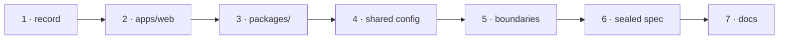

# W-44 — The monorepo layout: apps, packages, and room for what comes next

## At a glance

| | |
|---|---|
| **What** | Write SR-MONOREPO (layout, workspace and boundary rules, where a new product goes) and move the repository to it: `apps/` for runnable apps, `packages/` for the published packages |
| **Why** | Arpit: a PDF viewer, a PDF designer and a PDF creator are to be built in this repository too |
| **Done when** | The record is accepted; today's app runs from `apps/web`; the packages live under `packages/`; a check fails any import that crosses a boundary; a new product has a written place to go |
| **Status** | 🟢 ready · 0 of 7 DoD done |
| **Waits on** | nothing — W-29 and W-33 build inside this layout |
| **Who** | `agent` · Opus |
| **Record** | SR-MONOREPO (new) |



<details>
<summary><b>ASCII twin</b></summary>

```text
  1 record --> 2 apps/web --> 3 packages/ --> 4 shared config --> 5 boundaries --> 6 sealed spec --> 7 docs
```

</details>

**Arpit, 2026-10-18:** *"Maybe this repo needs to be created as a mono repo. Because in
future, we want to build out PDF viewer as well as PDF designer and creator inside the same
repo."*

**Model:** Opus: the layout every later product inherits.

## How it can be built — research, 2026-10-18

**Tooling, under L2 (open source and free only):**

| option | verdict |
|---|---|
| **npm workspaces** — built into npm | **recommended**, already chosen by SR-NPM-PACKAGES decision 11; no new tool |
| pnpm workspaces (MIT) | stricter and faster, but a second package manager for every contributor and CI |
| Nx (MIT core) | task graph and caching; its hosted cache (Nx Cloud) is paid — **forbidden by L2**; the free core is more machinery than seven packages need |
| Turborepo (MIT) | caching task runner; its remote cache is a paid hosted service — **forbidden by L2**; local cache allowed |

Reopen the choice when a full CI build passes 10 minutes — then Turborepo with a local cache only.

**Layout:**

```
apps/
  web/            today's app — Compare, Bulk, Spec, Inspect — a thin shell over @pdfsuite/ui
packages/
  core/  compare/  spec/  cli/  agents/  ui/  create/      (SR-NPM-PACKAGES)
tools/            generators, the sample set
testing/          blind batches, fixtures, results
records/  work/  docs/  archive/  scripts/  .github/
```

**Where the future products go** — written in the record, **no empty placeholder folders**:

| product | app | packages | note |
|---|---|---|---|
| PDF viewer | `apps/viewer` | `@pdfsuite/viewer` — W-42's viewer as a package, used by `apps/web` too | backlog B-015 |
| PDF designer | `apps/designer` | `@pdfsuite/template` (the template model), `@pdfsuite/designer` (editor screens) | backlog B-016 |
| PDF creator | — | `@pdfsuite/render` (template + data → PDF, locally, pdf-lib) | backlog B-017; **not** `creator` or `create` — `@pdfsuite/create` is the scaffolder |

Each needs Arpit's or Siddharth's ruling to start (L4 decision 6 — the package set changes).

**Rules for the record:**
- `apps/*` are private, never published; `packages/*` publish together at one version (L4).
- Direction: apps → packages; `ui` → domain packages → `core`; nothing imports an app; no
  package imports another's `src/` (SR-NPM-PACKAGES decision 6).
- One `tsconfig.base.json` with project references; each app has its own Vite config.
- Root scripts run per workspace: `npm run build -ws`, `npm test` across all.

## Definition of done

| DoD | what | state |
|---|---|---|
| 1 · record | SR-MONOREPO written (layout, tooling and its reopen trigger, dependency direction, future-product table) and accepted by Siddharth or Arpit | ⏳ |
| 2 · apps/web | today's app moved to `apps/web`, builds and runs unchanged | ⏳ |
| 3 · packages/ | `packages/` is W-29's home; root `workspaces: ["apps/*", "packages/*"]` | ⏳ |
| 4 · shared config | `tsconfig.base.json`, project references, root build and test scripts across workspaces | ⏳ |
| 5 · boundaries | a check fails an app importing an app, a package importing an app, or any cross-package `src/` import | ⏳ |
| 6 · sealed spec | `scripts/update-from-zip.sh` and `scripts/check-boundary.sh` follow the new paths; the spec machine told its refresh changed | ⏳ |
| 7 · docs | `CLAUDE.md` layout block, `docs/ARCHITECTURE.md`, `work/README.md` and the register's Ownership paths updated | ⏳ |

## Blockers

None. W-29 (packages) and W-33 (ui) build inside this layout — whichever lands first sets the paths the others follow.

## Record affected

**SR-MONOREPO** (new, DoD 1); SR-NPM-PACKAGES decision 11 points at it.

## Hazards

- **No number may move** — a move, not a change; every `cli/verify` run unchanged.
- **The sealed folder moves with the app** — never edit its contents from this machine (W-32).
- The touched files are W-01's, so commits stage `work/open/W-01-claim-components.md` too.

## Reference

- [SR-NPM-PACKAGES](../../records/0107_NPM-packages.md) · [SR-LAW-2](../../records/0004_LAW-2-open-source-only.md) · [SR-LAW-4](../../records/0006_LAW-4-how-packages-work.md)
- [W-29](W-29-npm-workspaces-packages.md) · [W-33](W-33-ui-package.md) · [W-42](W-42-pdf-viewer-popup.md) · [W-45](W-45-rename-repository.md)
