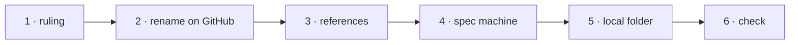

# W-45 — Rename the repository

## At a glance

| | |
|---|---|
| **What** | Rename `sid4861/pdf-testing-suite` to a name that covers testing, viewing, designing and creating PDFs, and update every reference in one change |
| **Why** | Arpit: the repository will hold a PDF viewer, designer and creator too, so "testing suite" no longer describes it |
| **Done when** | The repository answers at its new name; nothing in the repository, the CLI package, the scripts or the spec machine's procedure names the old one |
| **Status** | 🔴 needs a ruling · 0 of 6 DoD done |
| **Waits on** | Siddharth's or Arpit's ruling on the name and the owner (inbox) |
| **Who** | `agent` · Sonnet |
| **Record** | SR-MONOREPO |



<details>
<summary><b>ASCII twin</b></summary>

```text
  1 ruling --> 2 rename on GitHub --> 3 references --> 4 spec machine --> 5 local folder --> 6 check
```

</details>

**Arpit, 2026-10-18:** *"Maybe we need to change the repository name as well. File a work
item for all these things."*

**Model:** Sonnet: a mechanical rename once the name is ruled.

## The ruling owed — research, 2026-10-18

| option | for | against |
|---|---|---|
| **`pdfsuite`, under `sid4861`** (recommended) | matches the npm scope `@pdfsuite` and the `pdfsuite` command; repository names are per account, so it is free there | stays on a personal account |
| `pdfsuite` under a new GitHub organisation | shared ownership, team permissions | **the account name `pdfsuite` is taken** (one public repo, "download"); the organisation needs another name — e.g. `pdfsuite-dev` (unchecked) |
| a new product name | room for branding | the npm scope and command would no longer match |

GitHub redirects the old URL and old git remotes after a rename, but every reference is still
updated so nothing depends on the redirect. The rename is done by the repository's owner.

## What changes (found 2026-10-18)

| where | change |
|---|---|
| `cli/package.json` | `repository`, `homepage`, `bugs` URLs |
| `scripts/update-from-zip.sh` | its example names `pdf-testing-suite-main.zip`; make it accept any zip name |
| `src/features/spec/README.md` | names the old zip — **sealed: the spec machine edits it** |
| `CLAUDE.md`, `README.md`, `docs/` | the repository's name and links |
| `work/samples/excel-spec-template-v2/report*.pdf` | frozen PDFs may carry the old name in their metadata; W-37's generator rebuilds them |
| git remotes | `git remote set-url origin <new>` on every clone |
| the local folder on Arpit's Mac, the Cowork connection, the Claude Project name | renamed by Arpit when he chooses; a renamed folder must be reconnected |

## Definition of done

| DoD | what | state |
|---|---|---|
| 1 · ruling | the name and the owner chosen by Siddharth or Arpit | ⏳ |
| 2 · rename on GitHub | done by the repository's owner | ⏳ |
| 3 · references | every reference in the table above updated in one change; `grep -rn pdf-testing-suite` finds only the archive and old worklog entries | ⏳ |
| 4 · spec machine | told the new zip name; `update-from-zip.sh` accepts any zip name | ⏳ |
| 5 · local folder | Arpit renames and reconnects his local folder when he chooses; the Project renamed if wanted | ⏳ |
| 6 · check | CI, the package install test and the zip refresh pass at the new name | ⏳ |

## Blockers

- 🔴 **The name and the owner** — the inbox row in `OPEN-WORK.md`.

## Record affected

**SR-MONOREPO** (W-44) states the repository's name; SR-NPM-PACKAGES's package metadata follows.

## Hazards

- **Past worklog entries and the archive keep the old name** — history is not rewritten.
- **Do it between sessions** — a rename mid-session breaks open clones and the Cowork folder link.

## Reference

- [W-44](W-44-monorepo-layout.md) · [W-43](W-43-ci-cd-test-publish.md) · `cli/package.json` · `scripts/update-from-zip.sh`
