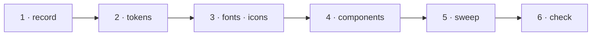

# W-50 — Proof, the design system, in code

## At a glance

| | |
|---|---|
| **What** | Turn `work/design/proof.css` into the app's styles: `--pdfsuite-*` tokens, IBM Plex shipped locally, stroke icons instead of emoji, the component classes; write SR-PROOF for its rules |
| **Why** | Arpit: recreate the UI on a simpler design system |
| **Done when** | Every screen draws from the tokens; no emoji or stray hex values remain in `src/` outside the sealed folder; SR-PROOF is accepted; the PDF viewer reads the same tokens |
| **Status** | 🟢 ready · 0 of 6 DoD done |
| **Waits on** | nothing — W-33 later moves it into `@pdfsuite/ui` |
| **Who** | `agent` · Sonnet |
| **Record** | SR-PROOF (new) |



<details>
<summary><b>ASCII twin</b></summary>

```text
  1 record --> 2 tokens --> 3 fonts + icons --> 4 components --> 5 sweep --> 6 check
```

</details>

**Arpit, 2026-10-18:** *"Recreate the UI based on a design system, which is a bit more simpler.
Create the design system as well as the UI."* … *"find a better name for design system."* —
named **Proof** in session.

**Model:** Sonnet: a style port with a written source to copy from.

## Definition of done

| DoD | what | state |
|---|---|---|
| 1 · record | SR-PROOF: one accent for action and selection; four change colours, each with a glyph; three statuses for verdicts only; numbers in mono with units; page first — and the token list | ⏳ |
| 2 · tokens | `src/styles/tokens.css` from `proof.css` `:root`, renamed `--pdfsuite-*`; `src/styles.css` reads only tokens | ⏳ |
| 3 · fonts · icons | IBM Plex Sans and Mono (OFL) bundled, no CDN (W-35); one inline stroke icon set replaces every emoji | ⏳ |
| 4 · components | buttons, segmented, underline tabs, chips, verdict, file pill, page strip, finding row, table, menu, dialog, banner, change highlights — as in `Main.dc.html` | ⏳ |
| 5 · sweep | no hex outside `tokens.css`; no emoji in UI text; change colours only where a change is drawn | ⏳ |
| 6 · check | `npm run build`; `sh scripts/check-boundary.sh`; contrast of every text token ≥ 4.5:1 on its ground | ⏳ |

## Blockers

None.

## Record affected

**SR-PROOF** (new) — owns `src/styles/` and `work/design/proof.css`'s rules.

## Hazards

- **The sealed folder** keeps its own `spec.css` and prefix rule; it adopts the tokens on the spec
  machine, by custom property only.
- **Diff colours are meaning:** removed / added / moved / restyled must stay distinguishable in
  greyscale — lightness differs, and a glyph always goes with the colour.

## Reference

- [`work/design/`](../design/README.md) — `proof.css`, `Main.dc.html`
- [W-51](W-51-screens-to-proof.md) · [W-33](W-33-ui-package.md) · [W-35](W-35-spa-any-url.md) · [W-42](W-42-pdf-viewer-popup.md)
