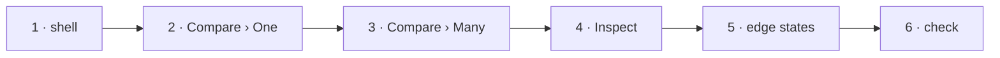

# W-51 — the screens, rebuilt to the Proof designs

## At a glance

| | |
|---|---|
| **What** | Lay out each tab as its board in `work/design/`: header with file pills and per-file *View*, the One · Many switch, side panels, report and export, pair pages, Inspect's panels, the edge states |
| **Why** | Arpit: recreate the UI on the simpler design system, for existing and coming features |
| **Done when** | Each screen matches its board at 1440 px and works at phone width; behaviour is unchanged; screenshots of each beside its board are in the PR |
| **Status** | 🟡 waiting · 0 of 6 DoD done |
| **Waits on** | W-50 · W-06 (names and the switch) |
| **Who** | `agent` · Opus |
| **Record** | SR-PROOF · SR-SURFACE-PARITY (presentation rows only) |



<details>
<summary><b>ASCII twin</b></summary>

```text
  1 shell --> 2 Compare One --> 3 Compare Many --> 4 Inspect --> 5 edge states --> 6 check
```

</details>

**Arpit, 2026-10-18:** *"Recreate the UI based on a design system … For all the features. Some could
be existing features, some newer features will be present in work documents."* … *"download all the
designs as well as the design system into work design directory. Create necessary work items."*

**Model:** Opus: many screens, no behaviour change allowed, phone layouts to get right.

## Definition of done

| DoD | what | state |
|---|---|---|
| 1 · shell | header, tabs, file pills with *View* (opens W-42's viewer when built; hidden before), sub-toolbar, page strip — `Compare-SideBySide.dc.html` | ⏳ |
| 2 · Compare › One | load, side by side + changes panel, overlapping + geometry, report + export menu, pair pages — five boards | ⏳ |
| 3 · Compare › Many | `Bulk.dc.html`: file lists, pairs table, progress, *Open* to One | ⏳ |
| 4 · Inspect | `Inspect.dc.html`: element panel and document tabs — fields not yet built (W-14…W-26) stay hidden until their item lands | ⏳ |
| 5 · edge states | `States.dc.html` styles ready for W-16, W-18, W-20, W-24 to use | ⏳ |
| 6 · check | build; boundary check; 1440 px and 390 px screenshots per screen; every flow in W-40 still passes | ⏳ |

## Out of scope

- **Specification** — the sealed tab; its layout (W-46, W-47 boards) is built on the spec machine.
- New behaviour: a board that shows a feature not yet built is a layout target, not a scope change.

## Blockers

- 🟡 W-50 · W-06.

## Record affected

SR-PROOF (from W-50); [SR-SURFACE-PARITY](../../records/0106_SURFACE-parity.md) presentation rows
unchanged in substance.

## Hazards

- **Behaviour must not move:** a layout change that alters what is compared or reported is a bug.
- **Feature flags:** every flagged element in the boards (comments, ZIP, JSON/CSV, Many) still
  obeys `flag.env`.

## Reference

- [`work/design/`](../design/README.md) · [W-50](W-50-proof-design-system.md) · [W-06](W-06-rename-workspace-tabs.md) · [W-42](W-42-pdf-viewer-popup.md)
