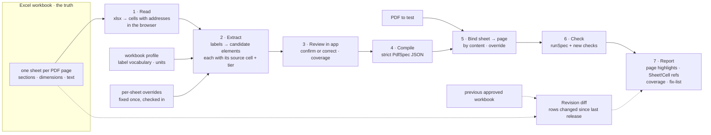

# Proposal — Excel as the spec

**Arpit, 2026-10-14:** *"PDF specs are maintained in Excel. Every sheet is one page
of a PDF … it contains sections, it contains dimensions. A PDF will get uploaded and
the Excel will get uploaded. We need to highlight what all things do not match those
Excel specs. Excel is the truth."*

> **Graduated 2026-10-16.** Arpit ruled every open question and edge case on
> 2026-10-16. The decisions now live in four records, and they win wherever this file
> differs: [SR-SPEC-INTAKE](../../records/0101_SPEC-intake.md) (the workbook, its
> validation, spec JSON), [SR-SPEC-CHECK](../../records/0102_SPEC-check.md) (checking a
> PDF), [SR-CONSTANTS](../../records/0103_CONSTANTS.md) (one constants file) and
> [SR-STACK-TYPESCRIPT](../../records/0104_STACK-typescript.md) (the spec pipeline is
> TypeScript only — no Python). The working name SR-SPEC-DRIVEN was not used. Built by
> [W-05](../open/W-05-constants-file.md), [W-02](../open/W-02-excel-spec-comparison.md)
> and [W-04](../open/W-04-spec-check-v2.md). This file stays as the research behind them.

**Tracked as** [W-02](../open/W-02-excel-spec-comparison.md) (intake) and
[W-04](../open/W-04-spec-check-v2.md) (checking).

This file is shaped like a record (§1 / §2) so graduation is a move, not a rewrite.

---

## §1 — For humans

**Excel is the truth; the PDF is checked against it.** The workbook is edited
when a page is designed or changed. A reviewer reads the workbook and changes the
PDF template. This feature closes the loop: drop the PDF and the workbook into the
app, and every place the PDF disagrees with the workbook is highlighted on the
page **and named by its Excel cell**.

**Nothing the workbook does not pin down is asserted, and nothing is silently
skipped.** Every spec row ends up checked, noted, or listed as unreadable, so the
reviewer sees coverage as well as failures.

**Today the Excel path does not work.** The app takes JSON only. A `.csv` or `.xlsx`
is rejected with a pointer to `tools/spec-from-excel.py`, and that script is not in
the repo.



<details>
<summary><b>ASCII twin</b></summary>

```text
  Excel workbook (truth)
     |
     v
  1 Read (xlsx -> cells + addresses) --> 2 Extract (labels -> elements, cell, tier)
                                             ^ profile    ^ overrides
                                             |
                                          3 Review in app (confirm / correct / coverage)
                                             |
                                          4 Compile (strict PdfSpec)
  PDF to test --------------------------> 5 Bind sheet -> PDF page
                                             |
                                          6 Check (runSpec + new checks)
                                             |
  previous workbook -> revision diff ---> 7 Report (highlights, Sheet!Cell, coverage, fix-list)
```

</details>

**The loop this serves:**


<details>
<summary><b>ASCII twin</b></summary>

```text
  workbook edited -> reviewer -> template changed -> PDF generated -> app check
                                            ^                                  |
                                            +------------ mismatch ------------+
                                                                  all pass -> release
```

</details>

---

## §2 — For agents

### Context — how Spec driven comparison works today

Read from the code on 2026-10-14.

| area | today | gap for "Excel is the truth" |
|---|---|---|
| **Input** | JSON only. The upload is labelled "CSV spec" and accepts `.csv`, then rejects it ([`SpecTestView.tsx`](../../src/components/spec/SpecTestView.tsx), [`specStore.ts`](../../src/store/specStore.ts) `loadSpecFile`) | no Excel path; the converter it points to, `tools/spec-from-excel.py`, is **not in the repo** |
| **Format** | [`spec-standard.md`](../../spec-standard.md) §2–7; types in [`spec.ts`](../../src/types/spec.ts) | §7 assumes one fixed column layout; [`tools/plan.md`](../../tools/plan.md) §2 says real tabs share no fixed layout |
| **Element types** | `text` (present, left/top, font size) · `image` (left/top, width, height) · `table` (left/top, width, rows, columns) · `paragraph` (left/top, line spacing) | no `section`/region, margins, font family, weight, style, rules, colour |
| **Locating** | nearest to declared top/left, or an `anchor` label ([`specCheck.ts`](../../src/services/specCheck.ts) `anchorRegion`) | good basis for sheets whose coordinates are unreliable |
| **Page mapping** | spec page = PDF page, or "One page" mode with a manual `pdfPageOverride` | no automatic sheet → page binding |
| **Validation** | `validateSpec` checks the top-level shape only | an unknown element type or a missing number fails confusingly |
| **Units** | `in` / `pt` / `mm`; default tolerances are inch values applied in any unit; unknown unit treated as inches | an `mm` workbook would fail everything |
| **Report** | per-element pass/fail, expected (dashed) vs actual box on the page; HTML and JSON export | no link back to the Excel cell; no count of what was **not** checked |
| **Tests** | `cli/verify/spec-target.ts` — page targeting only | no extraction or checker fixtures |
| **Security** | `units` inserted unescaped into the HTML export | must be escaped once workbooks are uploaded |

### Observed spec-sheet conventions (2026-10-14 sample)

A real spec workbook was reviewed for its **shape only**. What a parser and checker must handle:

| convention | consequence |
|---|---|
| A first **Pages List** sheet: tab, page name, page type (Required · Optional · Conditional, also the tab colour), comments | page binding and "is this page expected at all?" come from the index, not from sheet order |
| **Nested rows with merged cells**: Element › Sub-element › Item › Parameter group › Parameter › Description | the hierarchy lives in the merges; read merged ranges, never assume a fixed column per field |
| **Parameter groups**: Alignment · Size · Color · Image · Text, with parameters such as Vertical, Horizontal, Height, Width, Hex code, Wording, Font name/size/color/bold/italicize/underline/case, Line break, File name | the label vocabulary of decision 5 has a known core |
| **Values are prose with units inside**: "1 inches from left of page", ".75 inches", "14 pt" next to a bare "28"; some measured from the bottom edge | units and reference edges are parsed per cell |
| **Containers with contents** (coloured boxes holding text) | answers open question 4: a section is a bounded box *and* the parent of its elements |
| **Partial styling** ("only this word italic"), **conditional wording** ("NOTE: IF … use …"), **`<<dynamic>>`** with rules, **wrap points**, **line-break rules** | contextual tier unless a rule is mechanical; dynamic text becomes a pattern, not a literal |
| **IMPORTANT NOTE** boxes with cross-page or cross-system rules | recorded as notes; never asserted |
| **Landscape pages**; images referenced by file name; colours as hex + name + RGB | orientation and image identity become checks; colour stays a coverage line until colour checks exist |

The fictional fixture [`tools/samples/excel-spec-hierarchical/`](../../tools/samples/excel-spec-hierarchical/README.md)
reproduces this shape with invented content.

### Research summary

- **The plan in [`tools/plan.md`](../../tools/plan.md) is sound and is kept:** parse
  by label vocabulary, not column position (§3.2); a reviewable extraction artifact
  in the middle (§3.1); confidence tiers decide what is asserted (§3.3); anchors
  carry weak coordinates (§3.4); bind pages by content (§3.5); per-tab overrides
  (§3.6); an LLM only as a confirmed fallback (§3.7). This proposal does not restate
  those; it changes **where** the converter runs and adds what "Excel is the truth"
  needs.
- **The plan assumed a Python converter outside the app** (§5). The goal now is
  *upload the workbook in the app*, so parsing must run in the browser.
- **An `.xlsx` is a ZIP of XML (Office Open XML).** Sheets, shared strings, merged
  cells and bold fonts are all plain XML parts. The app already ships `jszip`, so a
  small in-house reader needs **no new dependency**.
- **Off-the-shelf readers carry costs.** SheetJS's npm package is stale at 0.18.5;
  current releases (0.20.3) install from its own CDN tarball. ExcelJS 4.4.0 was last
  published October 2023 and is about 250 KB gzipped with 9 dependencies.
- **One implementation, two front ends.** The Node CLI already reuses `src/services`
  through one seam ([`cli/src/platform/engine.ts`](../../cli/src/platform/engine.ts)).
  A TypeScript reader there serves the app and the Node CLI.
  A second Python converter would drift, as the two `generate` implementations
  already have.

### Decision (proposed)

1. **The workbook is the source of truth.** The JSON spec is a compiled artifact,
   never hand-edited, and every finding names the Excel cell it came from
   (`'Page 3'!C14`).
2. **The Spec driven comparison workspace accepts `.xlsx` directly.** Parsing runs in
   the browser; the workbook and PDF never leave the machine.
3. **One reader, in TypeScript, under `src/services/`**, with no new dependency:
   `jszip` + an XML parser for the SpreadsheetML parts (sheets, shared and inline
   strings, numbers, merged ranges, bold). Cached cell values are used; formulas are
   not evaluated. The Node CLI imports it through `engine.ts`.
4. **Three stages with a reviewable middle**, as `tools/plan.md` §3.1:
   workbook → `extraction` (candidates, source cell, tier) → compiled `PdfSpec`.
5. **A checked-in workbook profile** holds the label vocabulary and synonyms
   ("Distance from top", "Top margin" …), units and page-binding rules. A change in a
   sheet's wording edits the profile, not the code.
6. **Tiers decide assertion** (`tools/plan.md` §3.3): *certain* → asserted ·
   *inferred* → asserted with a wider tolerance and flagged · *contextual* → note
   only · *unusable* → coverage report only.
7. **Coverage is part of the verdict.** Every spec row ends as checked, noted or
   unreadable, with its cell. The report header reads *"N of M spec rows checked"*.
8. **A review step in the app** shows each sheet's extraction with cell references
   and tiers; corrections are saved as a per-sheet override file, committed beside
   the workbook. A human confirms once and the result is frozen.
9. **Sheet → page binding by content** (each sheet's most distinctive text found on a
   PDF page), with a mapping-file override and the existing manual override.
10. **The checker grows from the survey, not from guesses.** Expected first: font
    family, weight, style and case; a `container` element (a bounded box whose
    children must sit inside it); page orientation; image identity by file; graphs
    (vector-drawn and embedded as images). Colour stays unchecked until a workbook
    needs it, and shows in coverage meanwhile.
11. **Findings are written for the template developer:** expected (Excel), actual
    (PDF), delta, cell, and the correction to apply, plus the existing on-page
    highlight. Exports: HTML report and a Markdown fix-list.
12. **Revision diff (optional input):** given the previous approved workbook, list
    the rows changed since. That list is the change request; the check then confirms
    it was implemented.
13. **CLI parity:** `pdfsuite spec --workbook <xlsx> --pdf <pdf> [--profile <json>]`,
    with the existing exit codes and one JUnit testsuite per sheet.
14. **Fix today's spec defects first:** unit-aware tolerances, escape `units`, strict
    `validateSpec`, images inside Form XObjects.

### Delivery phases — each ships on its own

| phase | delivers | done when |
|---|---|---|
| **P0 · survey** | a read-only script listing labels, frequencies and sheet shapes across real workbooks | we know whether there are 3 recurring shapes or 30 |
| **P1 · foundations** | decision 14 fixes; line grouping that respects columns (side-by-side text on one baseline is merged today); strict validation; extraction + checker fixtures in `cli/verify/` | a deliberate regression fails a fixture |
| **P2 · read + extract** | xlsx reader; profile; extraction with cell refs and tiers; coverage view in the app (read-only) | any sheet shows what was found, where, and what was not |
| **P3 · check from Excel** | `.xlsx` upload compiles and checks in the app; findings cite cells; overrides | the user's ask works end to end on the surveyed shapes |
| **P4 · bind + extend** | content-based page binding; checker extensions the survey called for | a multi-sheet workbook checks with no page numbers typed |
| **P5 · change loop** | revision diff; Markdown fix-list; `pdfsuite spec` | a changed row shows up as a change and as pass/fail |
| **P6 · optional** | LLM fallback into extraction only, human-confirmed | only if P0–P4 leave a large unreadable residue |

### Consequences

- **Easier:** reviewers stop hand-converting; every mismatch traces to a cell; the
  CLI and the app judge a spec the same way, because they share one reader.
- **Harder:** the profile and the overrides become maintained files; how the
  workbook is written now affects results.
- **Owed:** fixtures built from real workbooks, which may need anonymising;
  `spec-standard.md` §7 rewritten around the profile instead of a fixed column layout.
- **Owns on graduation:** `src/services/specCheck.ts`, `src/services/specExport.ts`,
  `src/types/spec.ts`, `src/store/specStore.ts`, `src/components/spec/`, the new
  reader and extraction modules, `spec-standard.md`, `tools/plan.md` (retired into it),
  `public/samples/spec-sample.*`. This removes those paths from W-01.

### Alternatives considered

| option | why it loses |
|---|---|
| **Python converter outside the app** (`tools/plan.md` §5, openpyxl) | the user cannot upload a workbook in the app; a second implementation drifts from the checker |
| **SheetJS in the browser** | npm release stale (0.18.5); current builds come from a vendor CDN tarball; far more format than one sheet layout needs |
| **ExcelJS** | last published 2023; ~250 KB gzipped, 9 dependencies, for reading cells we can read with `jszip` |
| **Require one fixed workbook template** (`spec-standard.md` §7 columns) | cheapest if it can be enforced. Kept as the profile's default shape, but it cannot be assumed: the plan's own survey found no shared layout |
| **LLM-first extraction** | non-deterministic and unauditable on a compliance artifact; kept only as a confirmed fallback (decision 6, P6) |
| **Convert workbook → PDF mock and pixel-compare** | sheets describe intent, not pixels; compare mode already exists for golden PDFs |

### Open questions — all answered by Arpit, 2026-10-16

1. ~~**Samples.**~~ Real workbooks stay confidential and are never committed; the
   fictional fixture `tools/samples/excel-spec-hierarchical/` is the only committed
   sample (SR-SPEC-INTAKE decision 16).
2. ~~**Parser home.**~~ In-app TypeScript reader on `jszip`, no new dependency; no Python
   anywhere in the spec pipeline (SR-SPEC-INTAKE decision 3, SR-STACK-TYPESCRIPT).
3. ~~**`tools/spec-from-excel.py`.**~~ Written off; start fresh in TypeScript.
4. ~~**"Sections" and "dimensions".**~~ Answered by the sample: both — a container
   with its own alignment, size and colour, and the parent of its contents.
5. ~~**Who edits the profile and overrides.**~~ The profile became template v2 plus a
   legacy reader (SR-SPEC-INTAKE decisions 7–8); corrections go into the workbook or a
   checked-in overrides file (decision 15). The uploader is responsible for current files
   (decision 17).

### Reference (required)

- [`src/services/specCheck.ts`](../../src/services/specCheck.ts) — today's checker (`runSpec`, `validateSpec`, `checkText` …)
- [`src/components/spec/SpecTestView.tsx`](../../src/components/spec/SpecTestView.tsx) — today's upload and report UI
- [`spec-standard.md`](../../spec-standard.md) §5–8 and [`tools/plan.md`](../../tools/plan.md) §2–7 — the format and the earlier plan this builds on
- [SheetJS installation notes](https://docs.sheetjs.com/docs/getting-started/installation/frameworks) — npm registry stale at 0.18.5; current 0.20.3 from the SheetJS CDN
- [ExcelJS package health (depscope)](https://depscope.dev/pkg/npm/exceljs) — 4.4.0, last updated 2023-10-19, ~250 KB gzipped

### Veto condition

**Reopen this proposal if:** every workbook follows one fixed template, which
makes the profile and survey (decisions 5, P0) unnecessary.

**How to check it:** the answer to open question 1 or 4, recorded in W-02.

---

## Graduation trigger

**Graduated 2026-10-16 on Arpit's rulings**, before the build, so the build has records
to follow: the four records named at the top of this file. The spec components moved from
W-01 to those records in the Ownership table in the same change. This file is archived
([SR-WORK-LIFECYCLE](../../records/0053_WORK-lifecycle.md) decision 11) in the change
that closes the last of W-02 and W-04.
